# NG4 UI Recolor

| Original | NG4 UI Recolor |
|---|---|
| 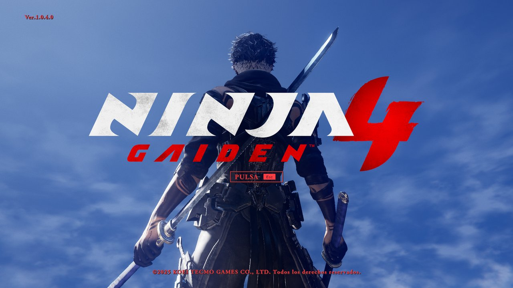 | 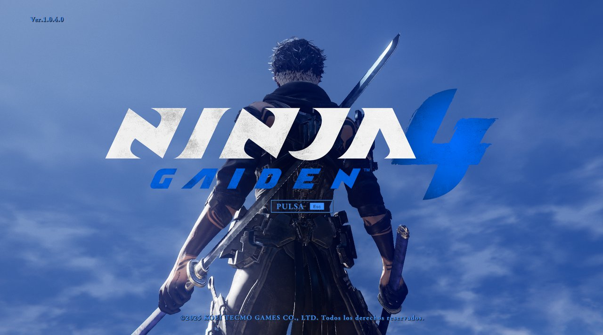 |

*Versión en español más abajo.*

## English

**NG4 UI Recolor** lets you change the red interface of **Ninja Gaiden 4** to any color you like.

### What it does
- Recolors menus, HUD, animations, tutorial prompts and the game logo with the color you choose.
- Keeps the shading: bright reds become bright tones of your color, dark reds become dark tones.
- Optional: intro and logo, menu particles, weapon and ninpo icons, and gameplay alerts
  (alerts keep their original red by default).
- Shows a preview before applying.

### How to use it
1. Close the game.
2. Open `NG4 UI Recolor.exe`. Nothing is installed.
3. Pick a color and click **Apply color**.
4. Start the game.

The first time, the tool saves a copy of the original game files (about 600 MB) next to the exe.
To go back to the original red, click **Restore originals**.

### Good to know
- Keep the exe in its own folder: the backup and your settings are saved next to it. To move it,
  move the whole folder. A copy of the exe on its own starts from scratch and makes a new backup.
- If the game is not found automatically, choose its folder with **Browse...**.
- Tested on the Steam version. Other versions have not been tested yet: if you try one, let us know.
- After a game update, use *Verify integrity of game files* in Steam, delete the `backup` folder
  and apply your color again.
- Some antivirus programs may warn about the exe because it is not digitally signed.

Unofficial fan mod, not affiliated with Koei Tecmo or Team NINJA.

---

## Español

**NG4 UI Recolor** te permite cambiar el rojo de la interfaz de **Ninja Gaiden 4** por el color que quieras.

### Qué hace
- Cambia el color de menús, HUD, animaciones, botones de los tutoriales y el logo del juego.
- Respeta el sombreado: los rojos vivos pasan a tonos vivos de tu color y los oscuros, a tonos oscuros.
- Opcional: intro y logo, partículas de los menús, iconos de armas y ninpo, y alertas de gameplay
  (las alertas conservan su rojo original por defecto).
- Muestra una vista previa antes de aplicar.

### Cómo se usa
1. Cerrá el juego.
2. Abrí `NG4 UI Recolor.exe`. No se instala nada.
3. Elegí un color y hacé clic en **Aplicar color**.
4. Abrí el juego.

La primera vez, la herramienta guarda una copia de los archivos originales del juego (unos 600 MB)
junto al exe. Para volver al rojo original, hacé clic en **Restaurar originales**.

### Para tener en cuenta
- Dejá el exe en su propia carpeta: la copia de seguridad y tu configuración se guardan junto a él.
  Para moverlo, mové la carpeta entera. Una copia suelta del exe empieza de cero y crea otra copia de seguridad.
- Si el juego no se detecta solo, elegí su carpeta con **Buscar...**.
- Probado en la versión de Steam. Las demás versiones todavía no se probaron: si lo usás en otra, contanos.
- Después de una actualización del juego, usá *Verificar integridad de los archivos* en Steam, borrá
  la carpeta `backup` y volvé a aplicar tu color.
- Algunos antivirus pueden advertir sobre el exe porque no tiene firma digital.

Mod no oficial, sin relación con Koei Tecmo ni Team NINJA.

---

## Screenshots / Capturas

| Original | NG4 UI Recolor |
|---|---|
| 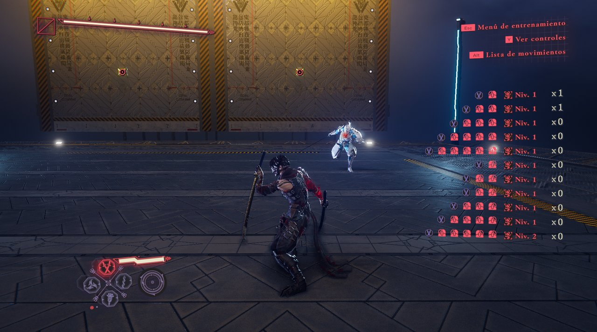 | 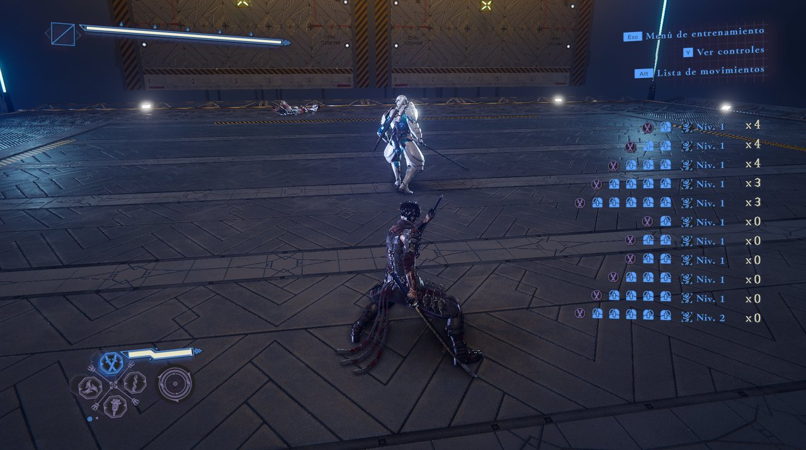 |
| 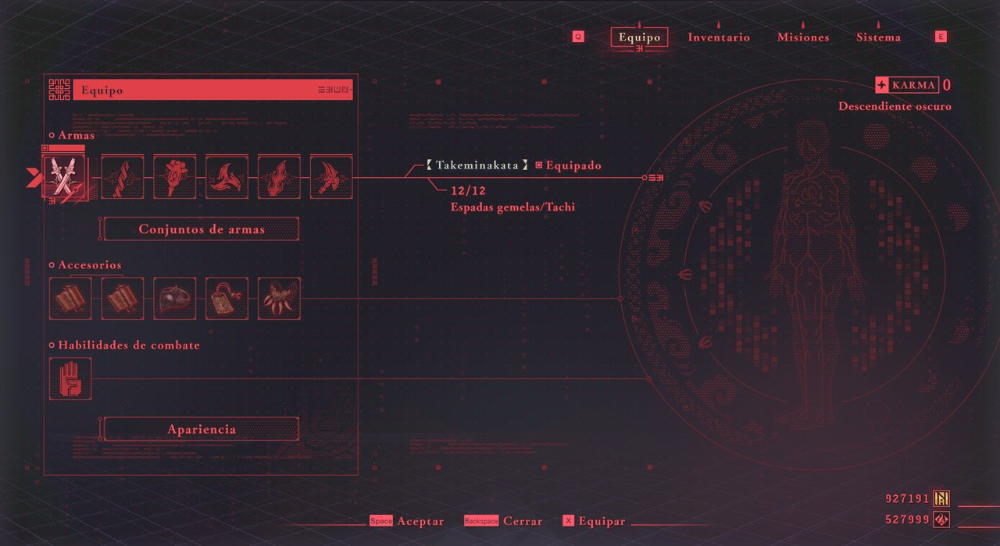 | 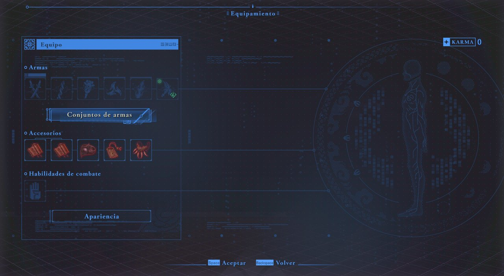 |
| 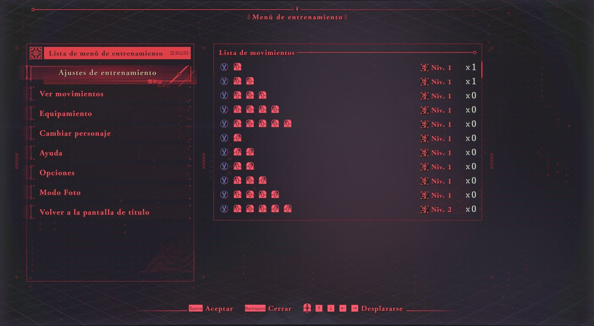 | 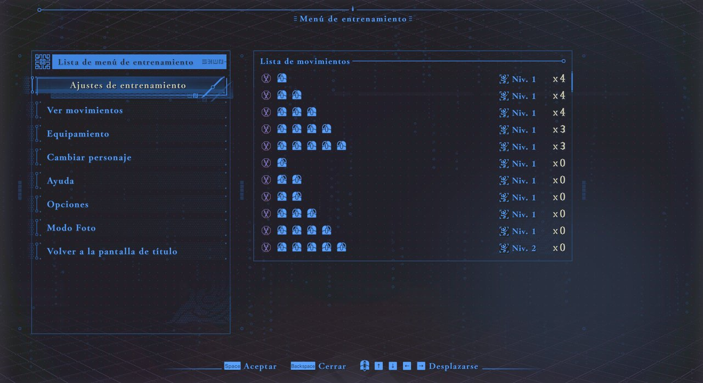 |
| 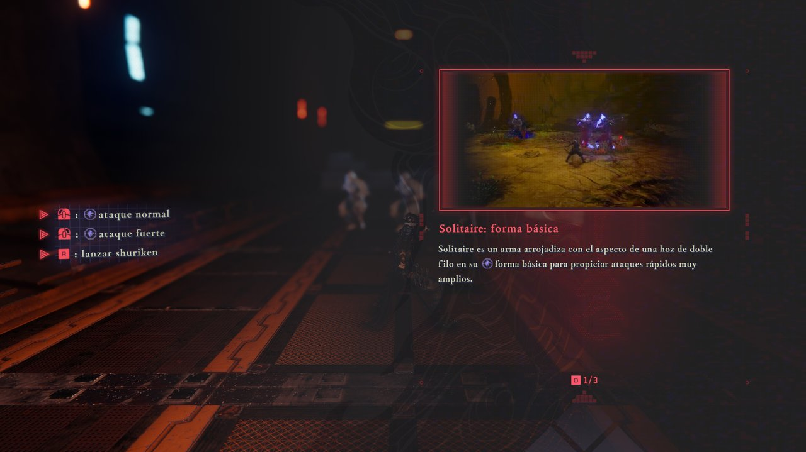 | 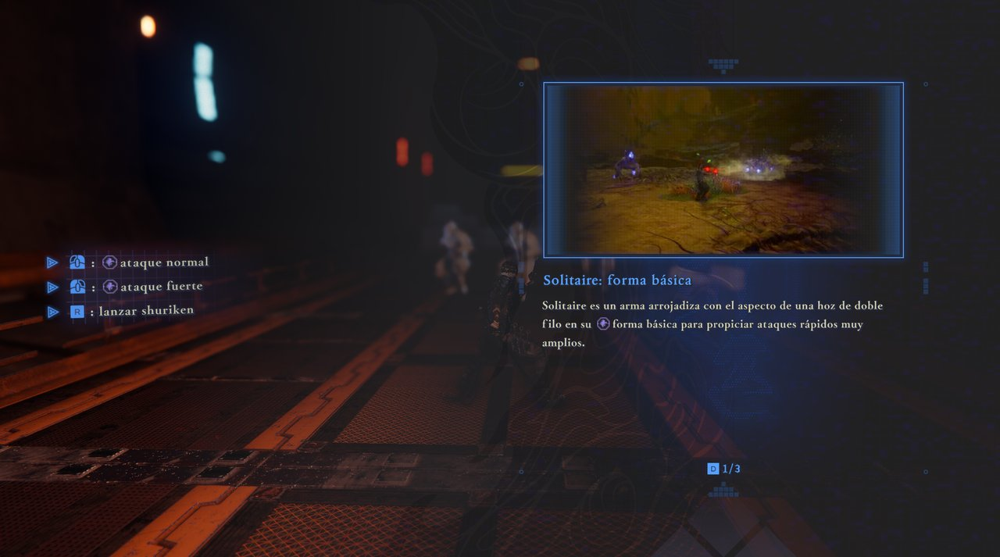 |

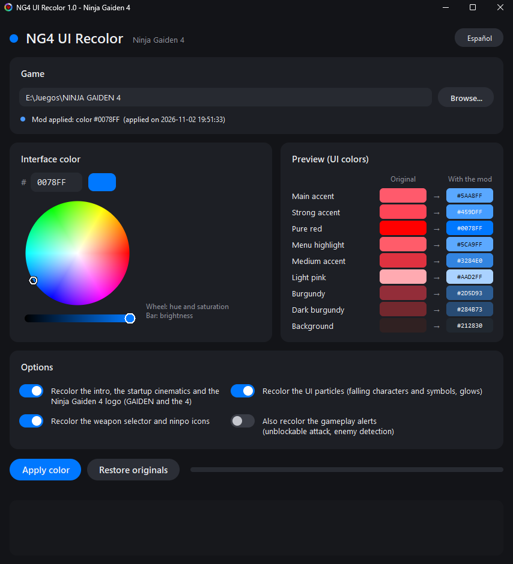
